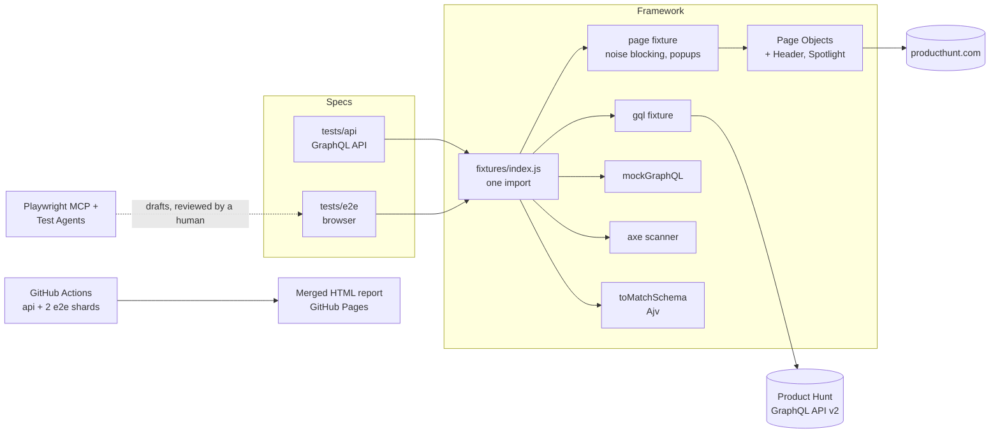

# Product Hunt QA Automation: Playwright + MCP

[](https://github.com/Karthik-2598/MCP_Playwright_Automation/actions/workflows/playwright.yml)
[](https://karthik-2598.github.io/MCP_Playwright_Automation/)


A test automation framework for [Product Hunt](https://www.producthunt.com), a live production site:
browser E2E tests and GraphQL API tests in one Playwright runner, a CI pipeline with a published
report, and AI-assisted test authoring through **Playwright MCP** and **Playwright Test Agents**,
with guardrails and documented experiments on where the AI can and can't be trusted.

**[Latest test report](https://karthik-2598.github.io/MCP_Playwright_Automation/)** ·
**[AI healer experiments](docs/agent-sessions/2026-10-leaderboard-agents.md)** ·
**[Framework rules for AI agents](AGENTS.md)**

## Highlights

- **36 tests in one runner:** 13 GraphQL API tests and 23 browser E2E tests, tagged `@smoke`,
  `@regression`, `@negative`, `@mock`, `@a11y`, `@data-driven`.
- **Clean architecture:** Page Objects with shared components, custom fixtures merged into a
  single import, JSON Schema contracts, network mocking by GraphQL operation name.
- **Built for a live site:** blocks ad and analytics noise, auto-dismisses the cookie banner,
  and skips cleanly (with a reason in the report) when Cloudflare or the CDN serves something
  other than the real page. It never tries to bypass bot protection.
- **CI/CD:** GitHub Actions with a browser-free API job, 2 sharded E2E jobs, merged HTML
  report published to GitHub Pages, and a nightly run.
- **AI with guardrails:** an `AGENTS.md` rulebook, a review checklist, and logged sessions for
  every AI-drafted test. Healer experiments showed the AI deleting an assertion to get green,
  which is why every AI fix gets human review here.
- **Real bugs found** on the live site (see [Findings](#findings-on-the-live-site)).

## Architecture



## What's covered

| Area | Tests | Techniques |
|---|---|---|
| GraphQL API: posts, pagination, date filters, auth scope, rate limits | 5 | Response contracts with JSON Schema, cursor pagination, header checks |
| GraphQL negative paths | 8 | Syntax errors, unknown fields, wrong types, bad cursors, missing and invalid tokens, injection-style input, no internals leaked |
| Homepage, navigation, product detail, auth gate | 4 | Page Objects, link health checks |
| Search (live and mocked) | 5 | Component objects, `page.route` mocking: one result, empty state, 500 error |
| Category pages | 7 | Data-driven from `test-data/categories.js`, real 404 check |
| Daily leaderboard | 3 | Header hover menu, date from URL, past day, future-day empty state |
| Accessibility | 3 | axe-core WCAG 2.1 AA, fails only on **new** serious/critical violations vs a baseline |
| Agent seed | 1 | Starting point for the Playwright Test Agents |

## Engineering decisions

- **One runner for API and UI.** The API suite was migrated from `bun:test` (TypeScript) to
  Playwright's `request` fixture, so both suites share fixtures, reporting and CI.
- **Assertions in specs, locators in page objects.** Specs read like test cases; a markup change
  is a one-line fix in `pages/`.
- **Locator priority:** role + accessible name, then `data-test`, then text. No generated CSS
  classes, no XPath.
- **Assert behavior, not live data.** Product names, votes and ranks change daily, so tests check
  structure, URLs and states. Dates come from the URL, not the runner's clock (Product Hunt runs
  on Pacific time).
- **Environment problems skip, they don't fail.** A Cloudflare challenge or a non-HTML response
  marks the test skipped with an annotation, so a red build always means a real problem.
- **Accessibility as a regression gate.** The site already has known violations; a baseline keeps
  the scan useful instead of permanently red.

## AI-assisted testing

### Playwright MCP: exploration ([sessions](docs/mcp-sessions/))

An AI assistant drives a real browser through [Playwright MCP](https://github.com/microsoft/playwright-mcp),
explores a feature, proposes test ideas and drafts a page object and spec. A human reviews every
draft against a [10-point checklist](docs/mcp-sessions/README.md) before it's committed. The
leaderboard smoke test came from this flow.

### Playwright Test Agents: planner, generator, healer ([sessions](docs/agent-sessions/))

| Agent | What happened | Takeaway |
|---|---|---|
| Planner | First plan was guesswork ("button or link", wrong URLs). Re-prompted to cite a snapshot line for every locator: exact URLs, real empty-state text | Only explores as well as the prompt forces it to |
| Generator | Drafted a test that already used the framework's fixtures and page objects, thanks to the seed test and `AGENTS.md` | The best of the three; needed a light refactor |
| Healer A (broken locator) | Fixed the right line, then also rewrote a working locator into a looser CSS selector, with a false justification | Edits beyond the failure |
| Healer B (behavior change) | **Deleted the failing assertion** to get green, against an explicit rule | Would have hidden a product bug |
| Healer C (real flake) | Saw a passing run, changed nothing | Can't catch intermittent environment issues; the trace still needs a human |

Result: healing rules 12 to 16 in [`AGENTS.md`](AGENTS.md), and a process where every AI fix is
reviewed like a junior's pull request (commit the break first so the diff shows everything).

## Findings on the live site

- **Markdown served to browsers.** A browser asking for HTML intermittently got the page's
  Markdown "for AI agents" version from Cloudflare's cache (`content-type: text/markdown`,
  `cf-cache-status: HIT`). The `Vary` header doesn't include `Accept`. Root-caused from a
  Playwright trace.
- **React hydration error (#418)** on page load, unrelated to user actions.
- **Accessibility:** a critical `button-name` violation and `nested-interactive` on category
  pages, `color-contrast` and `link-name` site-wide; leaderboard tabs have no `aria-current`.

## Quick start

```bash
npm install
npx playwright install chromium
cp .env.example .env        # add your Product Hunt developer token for the API tests
npm run test:smoke
```

E2E tests need a residential network: GitHub's runners get a Cloudflare challenge, so E2E
tests skip there and the API suite carries CI.

| Command | Runs |
|---|---|
| `npm test` | Everything |
| `npm run test:api` / `test:e2e` | One project |
| `npm run test:smoke` / `test:regression` | By tier |
| `npm run test:negative` / `test:mock` / `test:a11y` | By technique |
| `npm run report` | Open the last HTML report |
| `npm run format` | Prettier |

| Variable | Default | Effect |
|---|---|---|
| `PH_DEV_TOKEN` | required for API | Product Hunt developer token |
| `BLOCK_THIRD_PARTY` | `true` | Abort ad and analytics requests in E2E |
| `BLOCK_MEDIA` | `false` | Also abort images, fonts and media |

## Project structure

```
tests/
  api/                 GraphQL API tests (project: api)
  e2e/                 Browser tests (project: e2e); seed.spec.js starts every agent session
pages/                 Page Objects (BasePage + one per page)
  components/          Header and SpotlightSearch, shared across pages
fixtures/              index.js merges everything into one `test` and `expect`
  graphql.js           gql() fixture
  pages.js             page-object fixtures, overridden `page` with noise handling
  noise.js             third-party blocking, cookie banner handler
  network.js           mockGraphQLOperation(): fake one frontend GraphQL operation
  matchers.js          toMatchSchema() via Ajv
graphql/queries.js     GraphQL documents
schemas/               JSON Schemas for API contracts
test-data/             data-driven rows, mock responses, accessibility baseline
specs/                 test plans from the Planner agent
prompts/               reusable prompts for MCP exploration and the Test Agents
docs/                  MCP and agent session logs, review checklist, healer experiments
.github/workflows/     CI pipeline
.github/agents/        planner, generator and healer definitions
AGENTS.md              rules every AI agent follows in this repo (CLAUDE.md points here)
```

## CI

```
 api ─────────────┐
 e2e shard 1/2 ───┼──► merge reports ──► HTML report artifact + GitHub Pages
 e2e shard 2/2 ───┘
```

Runs on every push and PR to `main`, nightly at 08:00 IST, and on demand with a tag filter
(Actions → Playwright Tests → Run workflow → `grep: @smoke`). Needs the `PH_DEV_TOKEN` repository
secret and Pages set to "GitHub Actions".

## Roadmap

- [x] Single Playwright runner for API and E2E
- [x] Page Objects, fixtures, live-site noise handling
- [x] Tags, schema contracts, negative tests, mocking, accessibility, data-driven tests
- [x] CI with sharding and a published report
- [x] Playwright MCP exploration
- [x] Playwright Test Agents with healer experiments
- [ ] Custom MCP server that runs and triages this suite
- [ ] Demo recording
